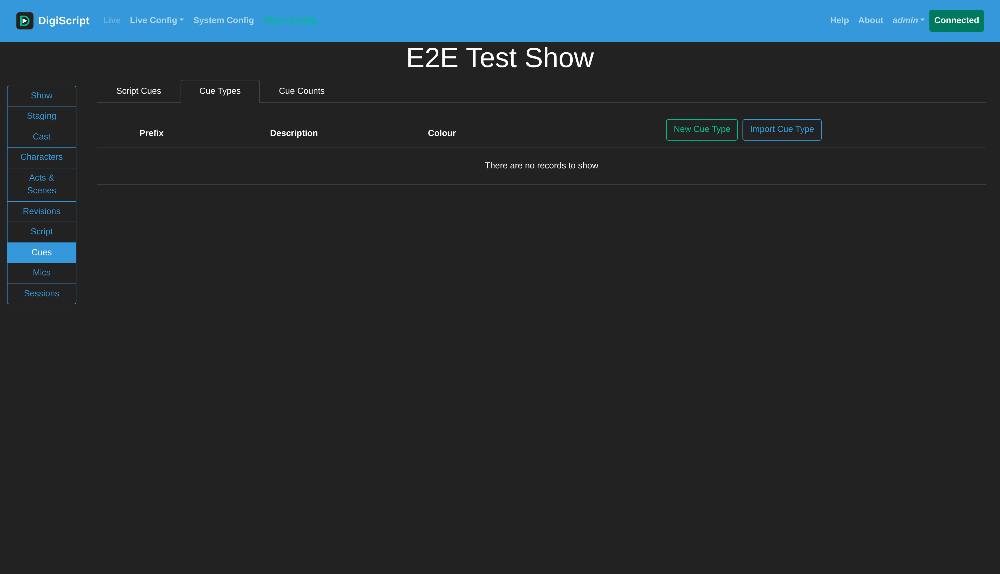
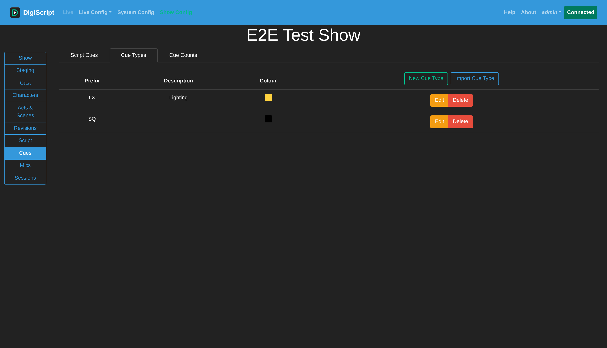
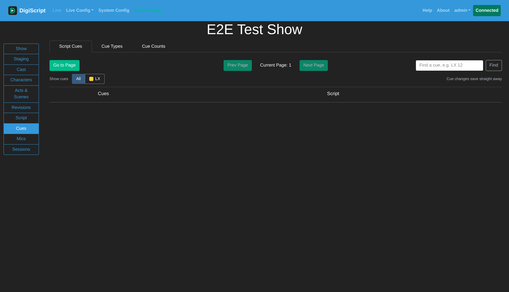
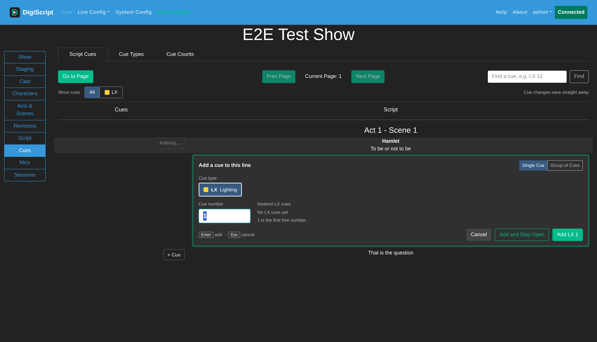
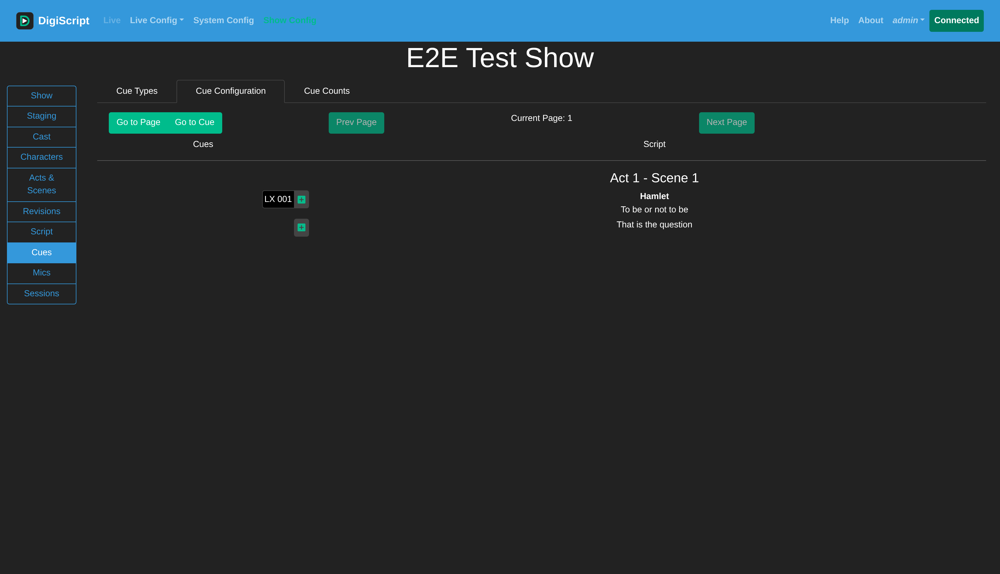
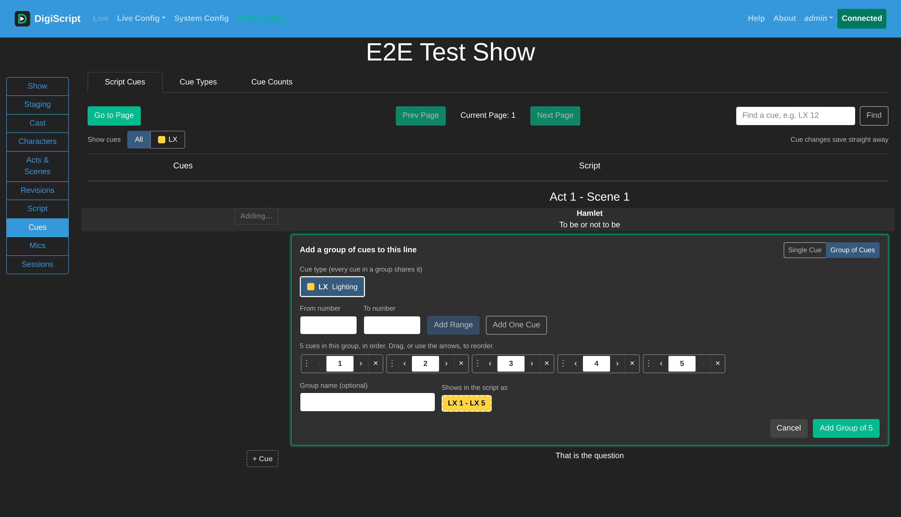
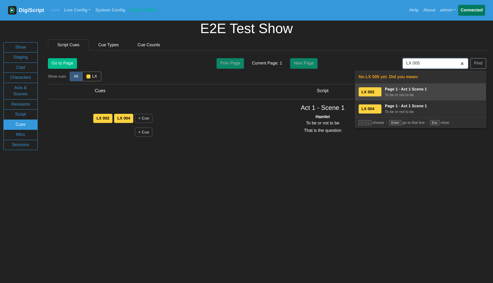

## Configuring Cues

Go to the **Cues** section in the left sidebar to add cues to your script and configure cue types. It has three tabs: **Script Cues** (where you place cues, and the first tab), **Cue Types** and **Cue Counts**.

### Cue Types

The **Cue Types** tab allows you to Add, Edit, and Delete different cue types. Common examples include Lighting (LX), Sound (SND), or other technical cues specific to your production. When you first access this page, you'll see an empty cue types list:

#### Creating Cue Types

Click **New Cue Type** to create a new cue type. For each cue type, you'll need to specify:
- **Prefix**: A short identifier (e.g., "LX" for lighting, "SND" for sound)
- **Description**: A full description of the cue type
- **Color**: A color code to visually distinguish this cue type in the interface

After adding cue types, they will appear in the cue types overview:

The color you choose will be used throughout DigiScript to make different cue types instantly recognizable during configuration and live shows.

#### Importing Cue Types from Another Show

If you have already configured cue types for another show, you can import them into the current show using the **Import Cue Type** button. This opens a panel listing all cue types from your other shows, grouped by show name. Click **Import** next to any cue type to add an independent copy to the current show — changes made after import do not affect the original show.

### Adding Cues to the Script

The **Script Cues** tab is where you place cues in your script. It is the first tab, and it opens by default. It shows your script in the same layout as the live view: character names above their lines, the act and scene as a heading wherever they change, and your cues in a column on the left. When you first open it, your script has no cues:

There is no edit mode and no Save button for the page. Every change saves as soon as you make it, and anyone else working on the show sees it straight away.

If the show has no cue types yet, the tab asks you to add some first. Choose one of the common types (LX, SND, FLY or VID) to open the **New Cue Type** form with it filled in, or use **New Cue Type** or **Import from Another Show** to go to the Cue Types tab. If you do not have permission to edit the show, the tab asks you to ask someone who does.

#### Moving around

At the top of the page:

- **Go to Page** opens a box to jump to a page number.
- **Prev Page** and **Next Page** move one page at a time. The current page is remembered.
- The **Find** box searches for a cue by its type and number (see [Finding a cue](#finding-a-cue)).
- **Show cues** lets you show only one cue type. **All** shows every type. The cues of other types, and their groups, are hidden while a type is chosen, but **+ Cue** stays on every line. The choice is remembered. If you add a cue of a hidden type, the filter goes back to **All** so you can see it.

This header stays in view as you scroll.

##### Cue Placement on Line Types

Cues can be attached to most line types in your script:

- **Dialogue Lines**: Standard placement for cues that occur during character speech
- **Stage Direction Lines**: Useful for cues that occur during action sequences or scene changes
- **Cue Lines**: Dedicated lines for placing cues without associated dialogue, particularly useful for cues between dialogue

Spacing lines do not support cues, as they are designed purely for visual spacing and are hidden during live shows, so they have no **+ Cue** button. If a whole line is cut, its **+ Cue** button is switched off and the cue column says **Line cut**; cues already on it can still be opened. If only part of a line is cut, you can still add cues to it.

##### Adding a Cue

Every line has a **+ Cue** button at the right of its cue column. To add a cue:

1. Click **+ Cue** on the line where the cue should happen. A card opens directly under the line, and the button reads **Adding…** while it is open.
2. Choose the **cue type**. The types you can change come first; any you cannot change are marked **View only**. If you have chosen a type in the **Show cues** filter, or used one recently, it is already chosen.
3. Check the **cue number**. DigiScript suggests the next number: the next whole number when there is room, or a decimal such as 13.5 when the cue goes between two neighbours. Type over it to use another number.
4. Click **Add LX 13.5** (it names the cue you are adding), or press **Enter**.

The card also shows the **nearest cues** of the same type, above and below, so you can see where the new cue sits. The cue number can be any text up to 50 characters (for example `13.5`, `A` or `INTRO`). If the number is already used by another cue of the same type, you are warned and told which page it is on, but you can still save.

**Add and Stay Open** adds the cue, keeps the card open and offers the next number, ready to type over. This is quick for placing a run of cues on one line. Press **Esc** or **Cancel** to close the card without adding anything. Only one card is open at a time; opening another, or changing page, closes the open one.

If a cue cannot be saved, the card stays open with an error and what you typed, so you can try again.

You can use the whole page without a mouse: **+ Cue**, the cue chips, the type buttons (arrow keys move between them) and the card's buttons can all be reached with Tab, and focus returns to the button you started from when the card closes.

After adding cues, they appear as coloured buttons in the cue column next to their lines:

The colour of each cue matches the colour of its cue type (or your own colour for it, if you have set one in your user settings), and a cue always shows its type's prefix, so you do not have to rely on colour alone.

##### Editing and Deleting a Cue

Click a cue to open it in a card under its line. You can change its type and number, then click **Save Cue**, or click **Delete Cue**. Deleting asks you to confirm and removes the cue from the current script revision only; other revisions keep it. Cues cannot be moved to another line.

If you do not have permission to change a cue's type, clicking it shows a note instead, such as **View only. You do not have permission to change LX cues.** (naming that cue's type) If you cannot change any cue type, you can still look at every cue, but there is no **+ Cue** button.

##### Cue Groups

When a song or sequence has many cues on the same script line (e.g., 100 LX cues for a timecoded intro), adding them all as individual buttons becomes unworkable. **Cue Groups** solve this by bundling multiple cues into a single button with an abbreviated label such as `LX 1 - LX 100` or `LX - Music Intro`.

To create a cue group:
1. Click **+ Cue** on a line, then **Group of Cues** at the top of the card. The cue type you chose is kept.
2. Choose the **cue type** (all cues in a group share one type).
3. Add cues with **Add Range**: enter whole numbers in **From number** and **To number** (for example 15 and 26) and click **Add Range** or press **Enter**. A range can hold up to 10,000 cues, and adding another range appends to the list. **From** starts at the suggested number when it is a whole number. **Add One Cue** adds a single empty cue to fill in.
4. Reorder the cues by dragging them, or with the **‹** and **›** buttons on each cue; the order decides the first and last numbers shown in the label. Use **×** to remove a cue.
5. Optionally enter a **Group name** (up to 100 characters), such as "Storm build". If you leave it blank, the label comes from the first and last cue. The card shows how the group will look in the script.
6. Click **Add Group of 12** (it shows the number of cues).

The group appears in the cue column as a button with a **dashed border**, making it visually distinct from individual cues.

Click a group to edit it in a card. You can change the name, and add, reorder or remove cues; the cue type is fixed once a group exists. **Delete Group** removes the group and all its cues after you confirm. If you have changed a group card and then try to close it, change page or open another card, DigiScript asks whether to discard your changes first.

A script line can freely mix individual cues and groups simultaneously.

##### Finding a Cue

Type a cue's type and number in the **Find** box, such as `LX 12`. After a short pause the matching cues are listed under the box, so you can see what you are about to jump to; nothing moves until you choose one. Press **Enter** or click **Find** to go straight to the cue without waiting. The search is not case-sensitive.

- If exactly one cue matches, **Enter** or **Find** opens its page, marks the line briefly and tells you where you went. While you are still typing, that one match is listed instead, so typing `LX 1` on the way to `LX 14` does not take you away from the page.
- If several cues match, they are listed with their page, act, scene and the start of their line. Use the up and down arrow keys to choose one and **Enter** to go to it, or click it. **Esc** closes the list.
- If none match, you are shown the closest numbers (**Did you mean:**), or told that no cues were found.
- If you type a number without a cue type, you are asked which type it is.

##### During a Live Show

While a show is running, you can still add cues, but changing and deleting cues is switched off until the session ends, and a banner at the top of the page says so. Open cards update as soon as a show starts or ends.

### Cues and Script Revisions

Cues are tied to script revisions - when you add or modify cues, the changes only affect the currently loaded revision. This allows you to maintain different cue configurations for different versions of your script.

Once you've configured your cues, you're ready to run a [Live Show](./live_show.md).