## Configuring the Script

Heading over to the **Script** section in the left sidebar will take you to the page where you can configure script revisions and the script itself.

### Script Revisions

The **Revisions** tab is where you can manage script revisions. The table shows all revisions of the script and allows you to Add, Delete, Edit, or Load a revision.

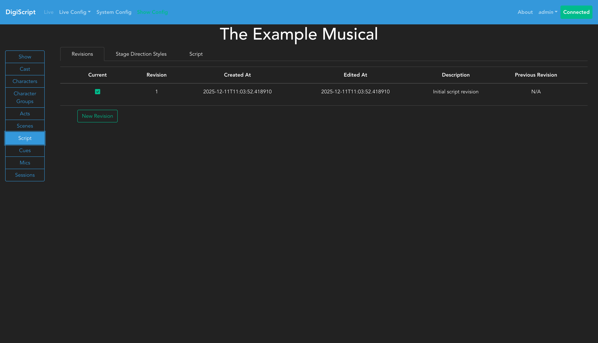

**With collaborative editing on**: if the current revision has an unsaved collaborative draft, loading, creating, or deleting revisions is blocked (with a tooltip explaining why) until the draft is saved or discarded. A banner at the top of this page offers a **Discard Draft** button for exactly this case — it warns if anyone is currently editing, since discarding reverts everyone's unsaved work, not just yours.

#### Understanding Script Revisions

Script revisions function similar to version control systems like Git - they track the state of your script at different points in time. This allows you to:
- Roll back the script to a previous version if needed
- Compare what has changed between revisions
- Maintain different versions of the script for different performances

#### Revision Branch Graph

The **Revision Branch Graph** provides a visual representation of your script's revision history, showing how revisions branch and evolve over time.

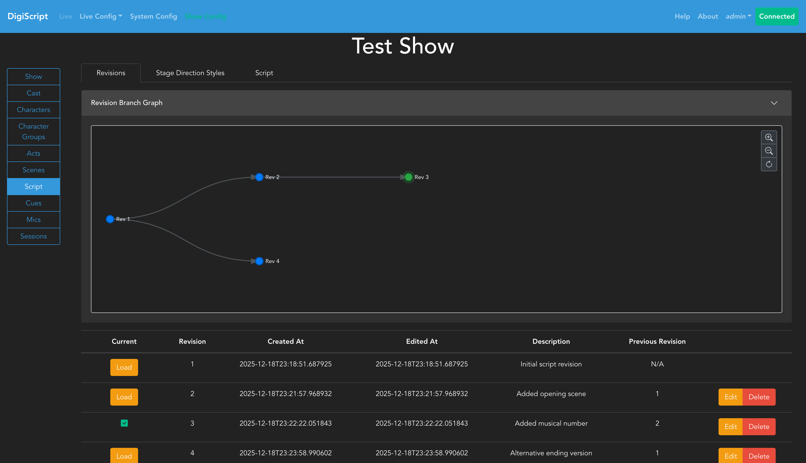

The graph displays:
- **Blue nodes**: Regular revisions
- **Green nodes**: The current active revision (with animated pulse effect)
- **Lines with arrows**: Show the parent-child relationship between revisions

##### Interacting with the Graph

You can interact with the revision graph in several ways:

**Clicking on Nodes**: Click any node in the graph to open a detailed modal showing:
- Revision metadata (number, description, dates)
- Previous (parent) revision
- Child revisions (branches created from this revision)
- Actions: Load This Revision, Create Branch From Here

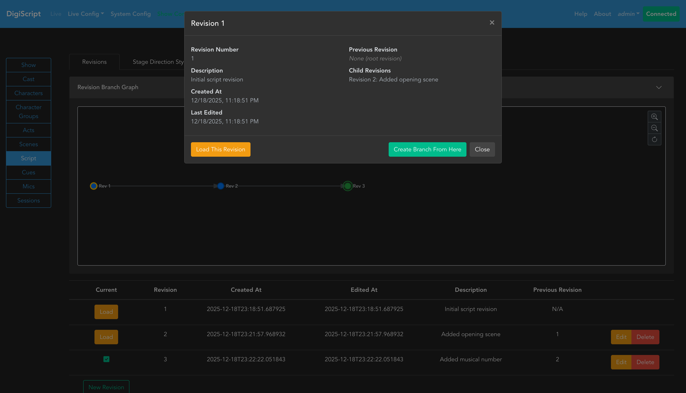

**Pan and Zoom**: Use your mouse or trackpad to pan around the graph and see all revisions. The zoom controls in the top-right corner allow you to:
- Zoom in (+)
- Zoom out (-)
- Reset zoom (↻)

**Collapse the Graph**: Click the chevron icon in the graph header to collapse/expand the graph card, saving screen space when not needed.

##### Creating Branches

You can create alternative versions of your script by branching from any revision:

1. Click on the revision you want to branch from
2. Click **Create Branch From Here** in the detail modal
3. Enter a description for the new branch
4. Click **OK**

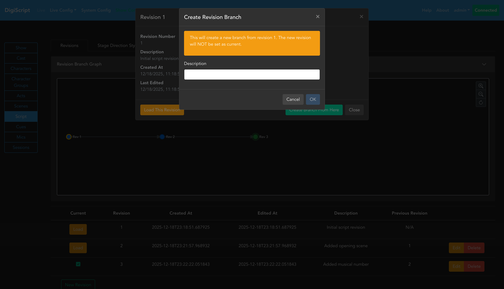

**Important**: When creating a branch from the current revision, the new revision becomes the active revision. When branching from a non-current revision, the new branch is created as an alternative version without changing which revision is currently loaded.

#### Creating a New Revision

Click **New Revision** to create a new revision. You'll need to provide a description for the revision to help identify it later.

When you create a new revision, its base state is copied from the currently loaded revision. Any changes you make to the script after that point will only affect the active revision - other revisions remain unchanged, preserving the complete history of your script.

### Stage Direction Styles

The **Stage Direction Styles** tab lets you define the visual appearance of stage direction lines throughout your script. Each style controls the text formatting applied when that style is assigned to a stage direction line.

#### Creating a New Style

Click **New Style** to open the style editor. You can configure:

- **Description** — a name for the style (e.g. "Narrator", "Whisper")
- **Default Styles** — toggle Bold, Italic, and Underline
- **Default Text Format** — Default, Uppercase, or Lowercase
- **Text Colour** — a colour picker for the text colour
- **Background Colour** — optionally enable and choose a background highlight colour

A live preview of the style is shown at the top of the editor so you can see how it will appear in the script before saving.

#### Importing Styles from Another Show

Click **Import Style** to open the import modal. This shows all stage direction styles from every other show in your DigiScript instance, grouped by show name. Each style is displayed with its live preview so you can see exactly what it will look like.

Click **Import** next to any style to copy it into the current show. The import creates an independent copy — changes to the imported style will not affect the original show, and vice versa. The modal stays open so you can import multiple styles in a single session.

If no other shows have stage direction styles defined, a message is shown indicating there are no styles available to import.

### Script Content

The **Script** tab is where you edit the actual script content. When you first navigate to this tab, you'll see an empty script interface:

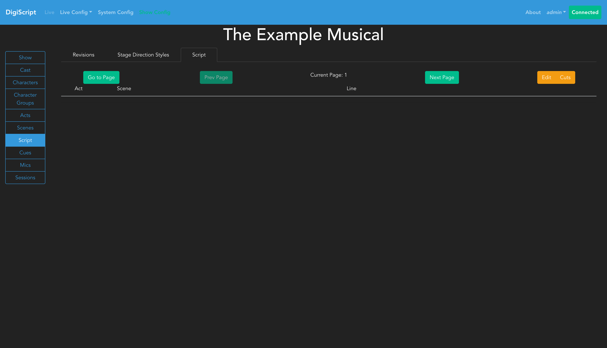

#### Editing the Script

DigiScript has two script editing experiences, chosen for the whole server by an admin via the **Collaborative Script Editing** setting (Settings page, General section). It cannot be changed while anyone is editing or cutting the script, a collaborative session has people in it, or an unsaved draft exists.

- **Off (default): Classic editing.** One person edits at a time, over a simple save/discard model. See [Classic Editing](#classic-editing) below.
- **On: Collaborative editing.** Several people can edit the script at once, with changes merging live and a shared autosaved draft. Only available in the current (non-legacy) interface. See [Collaborative Editing](#collaborative-editing) below.

Whichever mode is active, the rest of this page — line types, multi-part lines, page navigation — works the same way; only how you get into edit mode, and how you save, differs.

##### Classic Editing

To begin editing, click the **Begin Editing** button. This requests exclusive edit access from the backend, ensuring only one person can edit the script at a time to prevent conflicting changes.

Your edit access belongs to the browser tab you started editing in: each tab has its own connection identity, in both the current interface and the legacy one at `/ui-old/`, so another tab does not share it. (A tab created with the browser's **Duplicate tab** command is the exception: it starts as a copy of the original tab and shares its edit access.) If a different user logs in on a tab, that tab is given a new connection identity: the previous user's edit access never passes to them, and it is released after the usual grace period. Edit access survives a page reload: if you refresh the page, or your connection drops briefly, while editing, you come back still in edit mode, as long as you are still logged in as the same user. Unsaved changes in the script editor are lost on reload, so save before refreshing. If you close the browser, or it loses its connection for good, the lock is released a few seconds later and then other users can begin editing. Logging out normally releases it straight away. If your login had already expired, the lock is instead released once that page reloads or closes and its grace period ends, because an expired login can no longer use the lock.

Once you have edit access, you'll see options to **Save** the script, along with a dropdown button for **Add Dialogue** that provides access to all line types.

##### Collaborative Editing

Click **Edit** to join the shared draft as an editor. Unlike classic editing, several people can click **Edit** at the same time and edit different (or the same) lines together — concurrent changes merge automatically rather than overwriting each other. Everyone else viewing the script (not editing) sees the last *saved* content only; they won't see edits live until they join as an editor themselves.

Once editing, you get the same **Add Dialogue** dropdown and **Bulk Edit** (set the Act, Scene, Character or Character Group for a range of lines at once — pick a start line and an end line, then fill in the values to apply) as classic editing, plus:

- **Save** writes the shared draft to the database, visible to everyone (including non-editors) once it completes. Save is disabled while any line is still open for editing, or while the draft has a line that fails validation (the reason is shown as a tooltip) — fix or finish that line first.
- **Stop Editing** leaves the draft. If it has unsaved changes, you're asked to either **Keep Draft** (leave the unsaved draft in place — anyone, including you, can resume editing it later) or **Discard** (revert to the last saved content for everyone currently in the draft, not just you).
- If auto-save is enabled (User Settings), the draft saves itself periodically as a quiet toast notification rather than the classic editor's blocking "Saving Script" dialog — the collaborative draft is already synced to every other editor and checkpointed server-side, so a missed autosave tick is lower-stakes than classic's REST-only autosave. It silently skips a tick if the draft currently has an invalid line somewhere, rather than showing an error on every editor's screen — it catches up once that line is fixed.
- An **● Unsaved draft** indicator next to the page number tells everyone, editor or not, that there is unsaved work in progress, even if they aren't editing right now.

Cut mode (see below) is unavailable while a draft exists, and vice versa — editing and cutting are mutually exclusive in both modes.

#### Line Types

DigiScript supports four types of script lines, each serving a specific purpose:

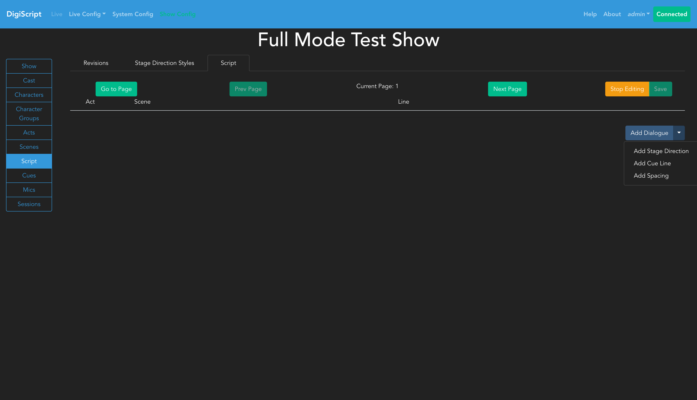

##### Dialogue Lines

The default line type for character speech. Dialogue lines:
- Require a character or character group assignment
- Can contain up to 4 parts (multi-part lines) in FULL mode

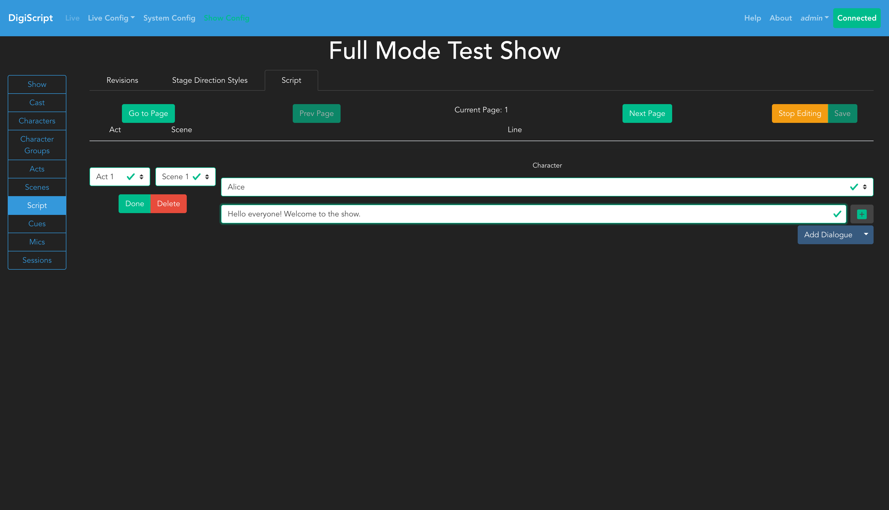

To create a dialogue line:
1. Click **Add Dialogue** (or select it from the dropdown)
2. Select the **Act** and **Scene** where the line occurs
3. Choose the **Character** or **Character Group** speaking the line
4. Enter the line content
5. Click **Done** to finish editing the line

##### Stage Direction Lines

Non-dialogue text for describing actions, movements, or technical directions. Stage direction lines:
- Contain a single text field
- Display in italic formatting with customizable styling
- Can be styled with Stage Direction Styles (system-level or user preferences)
- Optionally tagged to a character or character group (see below)

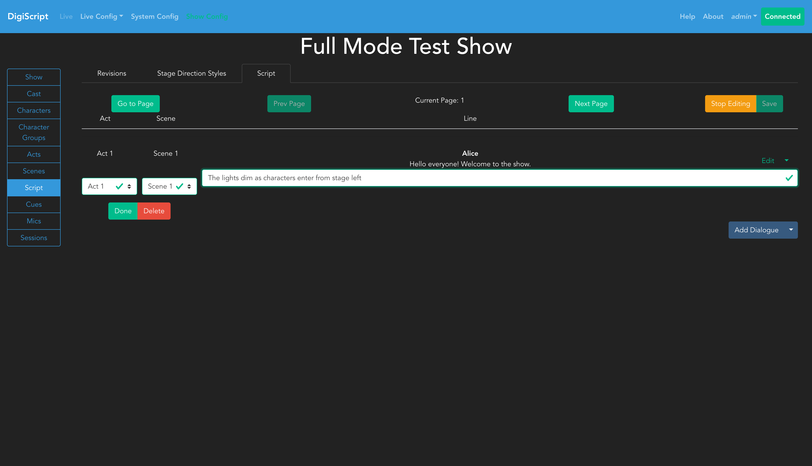

To create a stage direction, select **Add Stage Direction** from the dropdown menu.

###### Tagged Stage Directions

A stage direction can optionally be tagged to a **Character** or **Character Group**. This is useful when a stage direction is specific to a character and should appear visually under that character's heading in the script — for example, a move or action described directly after a character speaks.

To tag a stage direction:
1. In the line editor, use the **Character** or **Character Group** dropdown to select who the stage direction belongs to. Leave both as "N/A" for a generic (untagged) stage direction.
2. Only one of character or character group can be set — not both.

When a tagged stage direction is displayed in the script, a character heading appears above it (just as one does above dialogue) whenever the character has changed since the previous line. In the compact live view, the character name appears in the left-hand character column.

##### Cue Lines

Special lines designed for placing technical cues without associated dialogue. Cue lines:
- Have no editable content (displayed as "Cue Lines have no editable content")
- Provide a clean attachment point for cues (LX, SND, etc.)
- Are useful for cues that occur between dialogue or during pauses

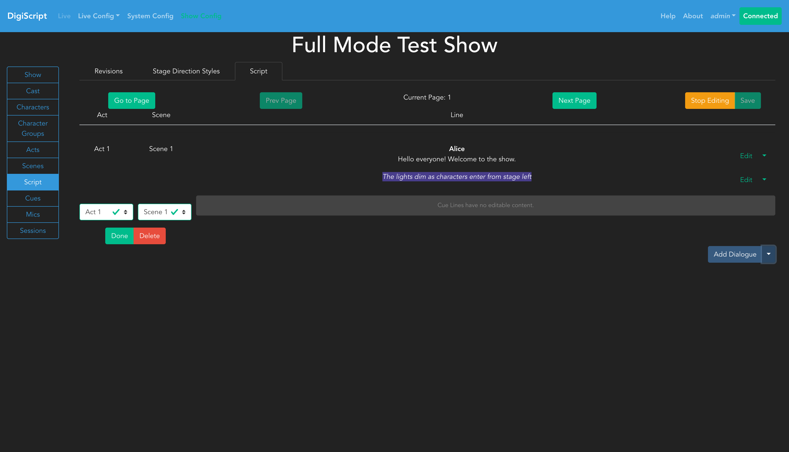

To create a cue line, select **Add Cue Line** from the dropdown menu.

##### Spacing Lines

Blank lines that add vertical spacing in your script. Spacing lines:
- Have no editable content (displayed as "Spacing Lines have no editable content")
- Are automatically hidden in live shows

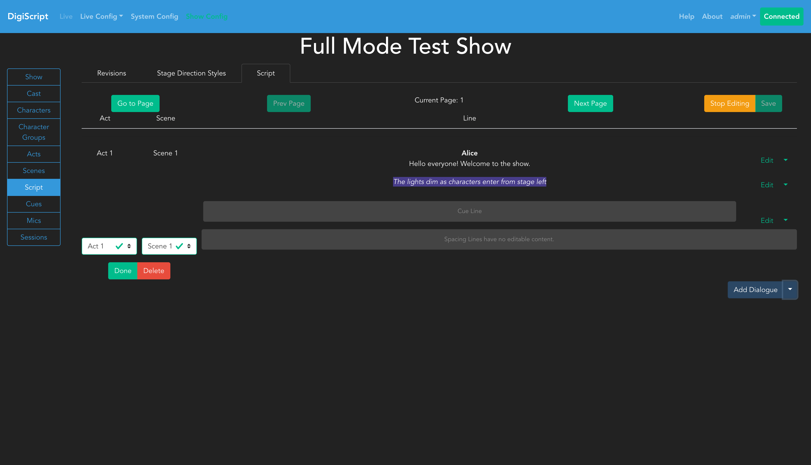

To create a spacing line, select **Add Spacing** from the dropdown menu.

**Important**: After clicking **Done**, DigiScript automatically creates a new empty line. If you don't need this line, click **Delete** before adding your next line. The script cannot be saved while lines are in edit mode.

#### Multi-Part Lines

Dialogue lines can be made up of multiple parts (up to 4 per line) in **FULL mode**. This is useful for:
- Songs where multiple characters sing simultaneously
- Scenes where characters talk over each other
- Parallel dialogue

Click the green plus button in the line editor to add additional line parts. These will display as multiple columns in the script view.

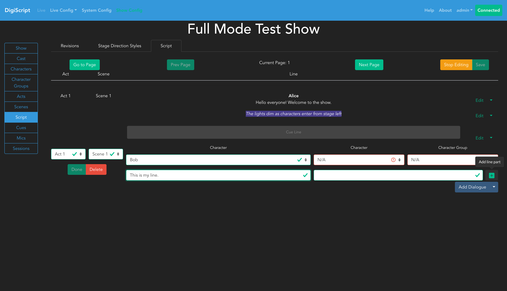

**Note**: In COMPACT mode, multi-part lines are not available as the layout is optimized for single-column display. The add button for additional parts will not be visible when editing shows configured with COMPACT mode.

#### Page Navigation

Use the **Prev Page** and **Next Page** buttons at the top of the editor to navigate between pages of your script as it grows.

#### Cut Mode

Instead of editing, you can click **Cuts** to mark line parts as cut for the live show, without changing the script content itself. Cut mode is exclusive with editing: it's blocked while anyone is editing or has an unsaved draft, and editing is blocked while someone is cutting. Saving cuts does not create a new script revision.

#### Saving Your Work

**Classic editing**: when you're ready to save, ensure no lines are in edit mode, then click the green **Save Script** button. Your changes will be saved to the currently loaded revision.

**Collaborative editing**: click **Save** at any time while editing (see [Collaborative Editing](#collaborative-editing) above) — there's no separate "finish editing first" step, since a draft can be saved while other editors keep working on it.

#### View Mode

After saving, you can switch to view mode to see how the script will appear during a live show:

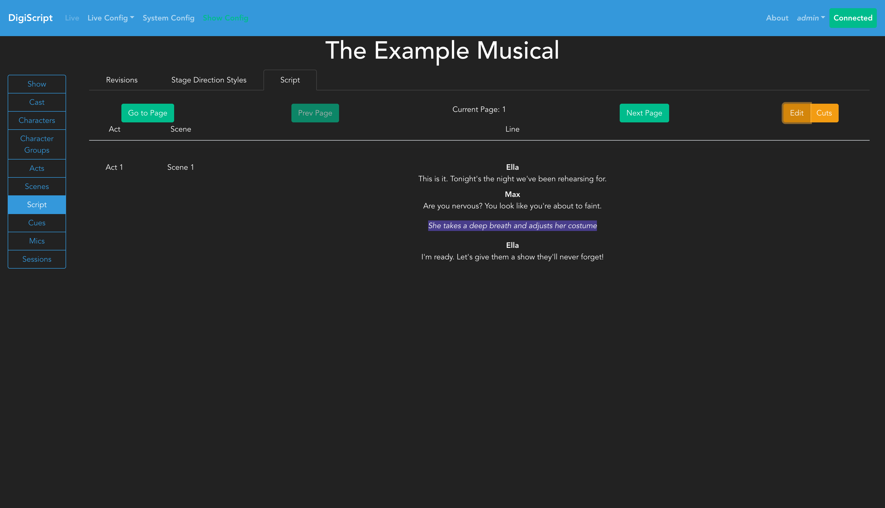

View mode provides a clean reading interface without the editing controls, similar to what you will see during the show.

Once the script has been configured, you can [Configure Cues](./cue_config.md) or learn how to run a [Live Show](./live_show.md).