## Configuring the Script

Heading over to the **Script** section in the left sidebar will take you to the page where you can configure script revisions and the script itself.

### Script Revisions

The **Revisions** tab is where you can manage script revisions. The table shows all revisions of the script and allows you to Add, Delete, Edit, or Load a revision.

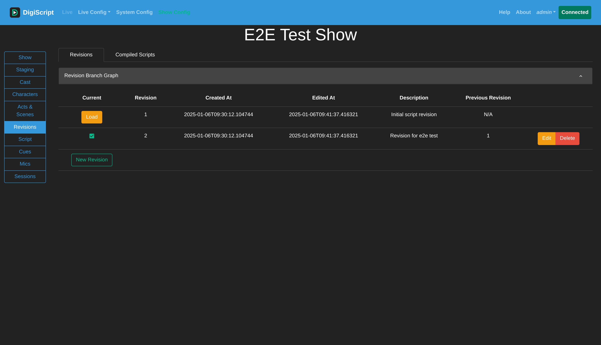

**With collaborative editing on**: if the current revision has an unsaved collaborative draft, loading, creating, or deleting revisions is blocked (with a tooltip explaining why) until the draft is saved or discarded. A banner at the top of this page offers a **Discard Draft** button for exactly this case — it warns if anyone is currently editing, since discarding reverts everyone's unsaved work, not just yours.

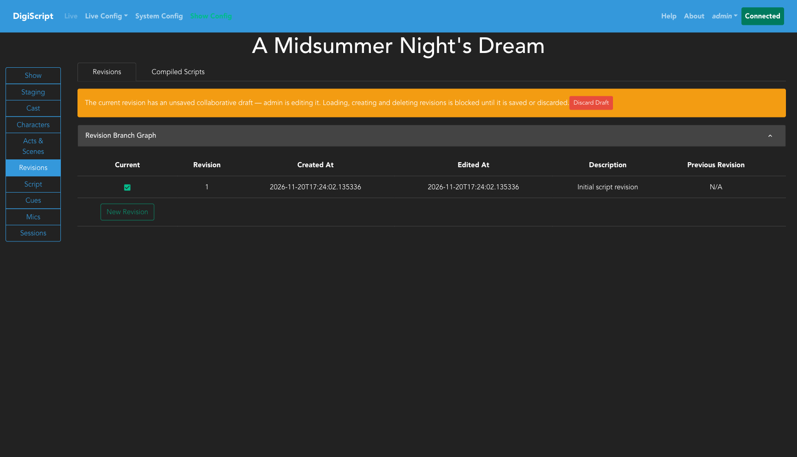

#### Understanding Script Revisions

Script revisions function similar to version control systems like Git - they track the state of your script at different points in time. This allows you to:
- Roll back the script to a previous version if needed
- Compare what has changed between revisions
- Maintain different versions of the script for different performances

#### Revision Branch Graph

The **Revision Branch Graph** provides a visual representation of your script's revision history, showing how revisions branch and evolve over time.

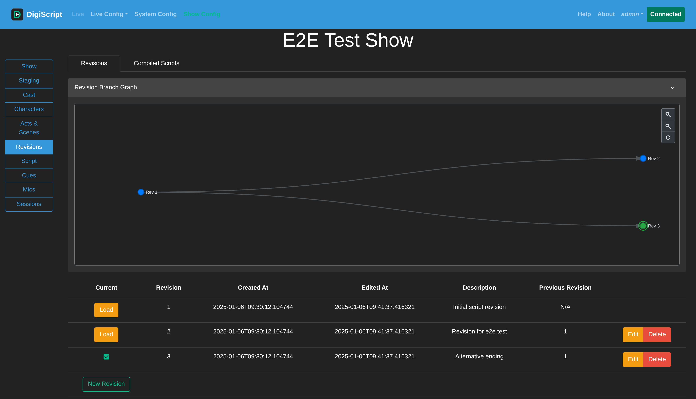

The graph displays:
- **Blue nodes**: Regular revisions
- **Green nodes**: The current active revision (with animated pulse effect)
- **Lines with arrows**: Show the parent-child relationship between revisions

##### Interacting with the Graph

You can interact with the revision graph in several ways:

**Clicking on Nodes**: Click any node in the graph to open a detailed modal showing:
- Revision metadata (number, description, dates)
- Previous (parent) revision
- Child revisions (branches created from this revision)
- Actions: Load This Revision, Create Branch From Here

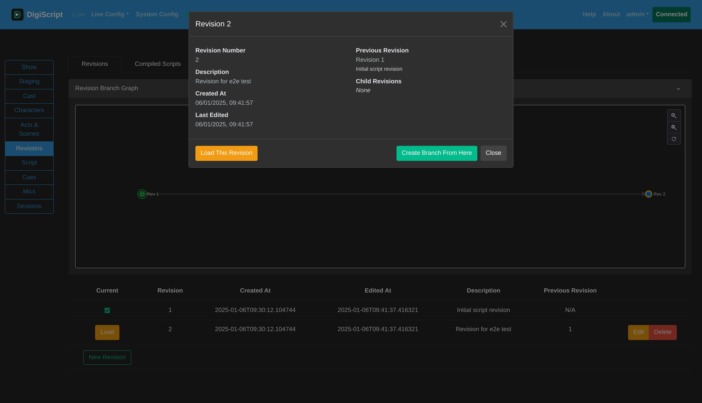

**Pan and Zoom**: Use your mouse or trackpad to pan around the graph and see all revisions. The zoom controls in the top-right corner allow you to:
- Zoom in (+)
- Zoom out (-)
- Reset zoom (↻)

**Collapse the Graph**: Click the chevron icon in the graph header to collapse/expand the graph card, saving screen space when not needed.

##### Creating Branches

You can create alternative versions of your script by branching from any revision:

1. Click on the revision you want to branch from
2. Click **Create Branch From Here** in the detail modal
3. Enter a description for the new branch
4. Click **OK**

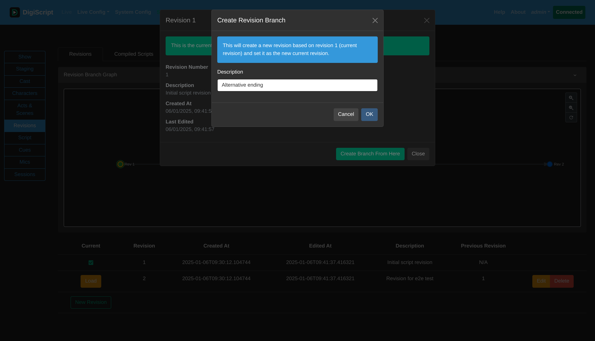

**Important**: When creating a branch from the current revision, the new revision becomes the active revision. When branching from a non-current revision, the new branch is created as an alternative version without changing which revision is currently loaded.

#### Creating a New Revision

Click **New Revision** to create a new revision. You'll need to provide a description for the revision to help identify it later.

When you create a new revision, its base state is copied from the currently loaded revision. Any changes you make to the script after that point will only affect the active revision - other revisions remain unchanged, preserving the complete history of your script.

### Stage Direction Styles

The **Stage Direction Styles** tab lets you define the visual appearance of stage direction lines throughout your script. Each style controls the text formatting applied when that style is assigned to a stage direction line.

#### Creating a New Style

Click **New Style** to open the style editor. You can configure:

- **Description** — a name for the style (e.g. "Narrator", "Whisper")
- **Default Styles** — toggle Bold, Italic, and Underline
- **Default Text Format** — Default, Uppercase, or Lowercase
- **Text Colour** — a colour picker for the text colour
- **Background Colour** — optionally enable and choose a background highlight colour

A live preview of the style is shown at the top of the editor so you can see how it will appear in the script before saving.

#### Importing Styles from Another Show

Click **Import Style** to open the import modal. This shows all stage direction styles from every other show in your DigiScript instance, grouped by show name. Each style is displayed with its live preview so you can see exactly what it will look like.

Click **Import** next to any style to copy it into the current show. The import creates an independent copy — changes to the imported style will not affect the original show, and vice versa. The modal stays open so you can import multiple styles in a single session.

If no other shows have stage direction styles defined, a message is shown indicating there are no styles available to import.

### Script Content

The **Script** tab is where you edit the actual script content. When you first navigate to this tab, you'll see an empty script interface:

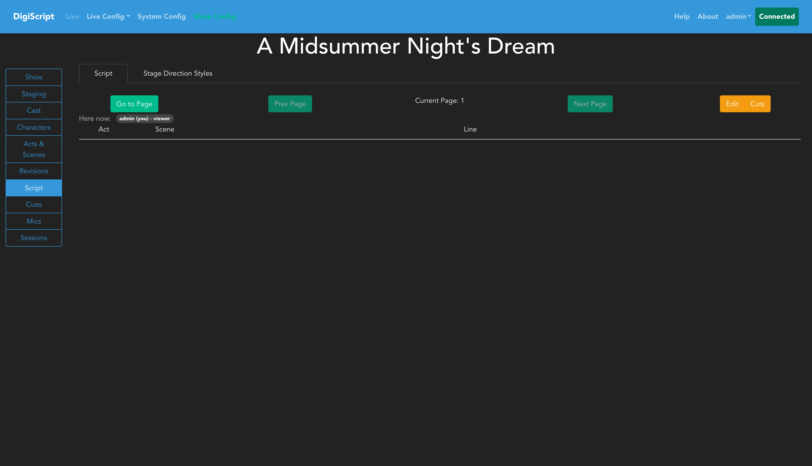

#### Editing the Script

DigiScript has two script editing experiences, chosen for the whole server by an admin via the **Collaborative Script Editing** setting (Settings page, General section). It cannot be changed while anyone is editing or cutting the script, a collaborative session has people in it, or an unsaved draft exists.

- **Off (default): Classic editing.** One person edits at a time, over a simple save/discard model. See [Classic Editing](#classic-editing) below.
- **On: Collaborative editing.** Several people can edit the script at once, with changes merging live and a shared autosaved draft. See [Collaborative Editing](#collaborative-editing) below.

Whichever mode is active, the rest of this page — line types, multi-part lines, page navigation — works the same way; only how you get into edit mode, and how you save, differs.

##### Classic Editing

To begin editing, click the **Begin Editing** button. This requests exclusive edit access from the backend, ensuring only one person can edit the script at a time to prevent conflicting changes.

Your edit access belongs to the browser tab you started editing in: each tab has its own connection identity, so another tab does not share it. (A tab created with the browser's **Duplicate tab** command is the exception: it starts as a copy of the original tab and shares its edit access.) If a different user logs in on a tab, that tab is given a new connection identity: the previous user's edit access never passes to them, and it is released after the usual grace period. Edit access survives a page reload: if you refresh the page, or your connection drops briefly, while editing, you come back still in edit mode, as long as you are still logged in as the same user. Unsaved changes in the script editor are lost on reload, so save before refreshing. If you close the browser, or it loses its connection for good, the lock is released a few seconds later and then other users can begin editing. Logging out normally releases it straight away. If your login had already expired, the lock is instead released once that page reloads or closes and its grace period ends, because an expired login can no longer use the lock.

Once you have edit access, you'll see options to **Save** the script, along with a row of **Add Dialogue** / **Add Direction** / **Add Cue** / **Add Gap** buttons at the end of the page, and a **+ Add Line Here** divider between every pair of existing lines for inserting one in the middle.

##### Collaborative Editing

Click **Edit** to join the shared draft as an editor. Unlike classic editing, several people can click **Edit** at the same time and edit different (or the same) lines together — concurrent changes merge automatically rather than overwriting each other. Everyone else viewing the script (not editing) sees the last *saved* content only; they won't see edits live until they join as an editor themselves.

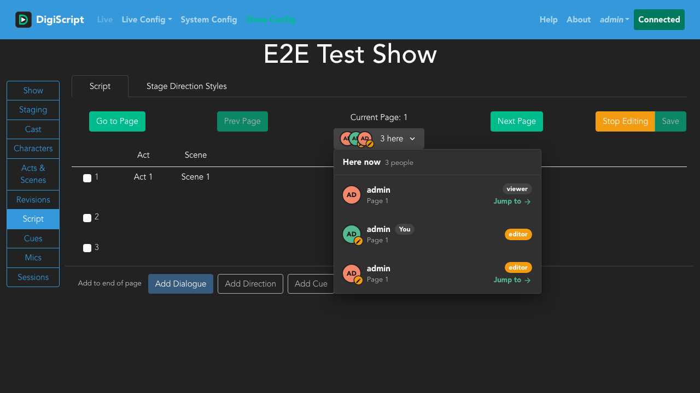

Once editing, you get the same add-line controls and line selection (tick line numbers to **Set Character or Group** or **Move to Scene** across several lines at once — see [Selecting Several Lines](#selecting-several-lines) below) as classic editing, plus:

- **Save** writes the shared draft to the database, visible to everyone (including non-editors) once it completes. Save is disabled while any line is still open for editing, or while the draft has a line that fails validation (the reason is shown as a tooltip) — fix or finish that line first.
- **Stop Editing** leaves the draft. If it has unsaved changes, a confirmation dialog asks you to choose **Keep Editing** (cancel and stay in the draft), **Keep Draft** (leave the unsaved draft in place — anyone, including you, can resume editing it later), or **Discard** (revert to the last saved content for everyone currently in the draft, not just you).

  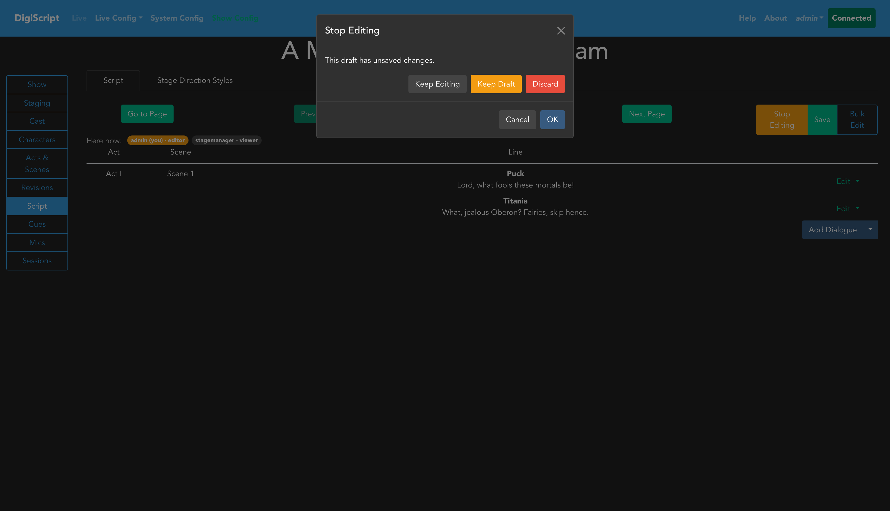
- If auto-save is enabled (User Settings), the draft saves itself periodically as a quiet toast notification rather than the classic editor's blocking "Saving Script" dialog — the collaborative draft is already synced to every other editor and checkpointed server-side, so a missed autosave tick is lower-stakes than classic's REST-only autosave. It silently skips a tick if the draft currently has an invalid line somewhere, rather than showing an error on every editor's screen — it catches up once that line is fixed.
- An **● Unsaved draft** indicator next to the page number tells everyone, editor or not, that there is unsaved work in progress, even if they aren't editing right now.

  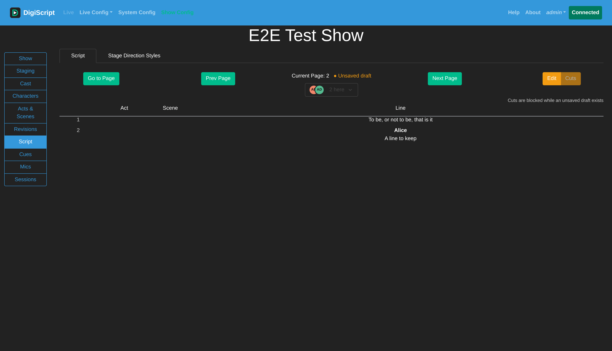
- A **"Here now"** presence button next to the page number shows a stack of avatars (up to four, then a **+N** overflow) and how many people are here. Click it to open the full list: everyone currently viewing or editing the script, including you (marked with a **You** pill), with their role — **editor**, **viewer**, or **cutting** (a viewer who has joined to cut — see Cut Mode below) — and, for anyone with the live draft open, which page they're on and how many lines they have open. It updates live as people join, leave, or move around.

  Click **Jump to** on anyone else's row to go straight to them: if they're on a different page, you're taken there; if they're already on your page with a line open, that line scrolls into view and briefly highlights.
- An avatar with a user's name appears directly on any line that a connected session currently has open for editing — including your own session in another tab, not just other people's. The avatar carries a small pencil badge, and the line itself gets a highlighted border, matching the "editing" colour used elsewhere on this page. It appears even on a line you yourself also have open at the same time (shown instead as a note on your own open editor, so it doesn't collide with your own controls), and clears as soon as they close that line (or disconnect).

  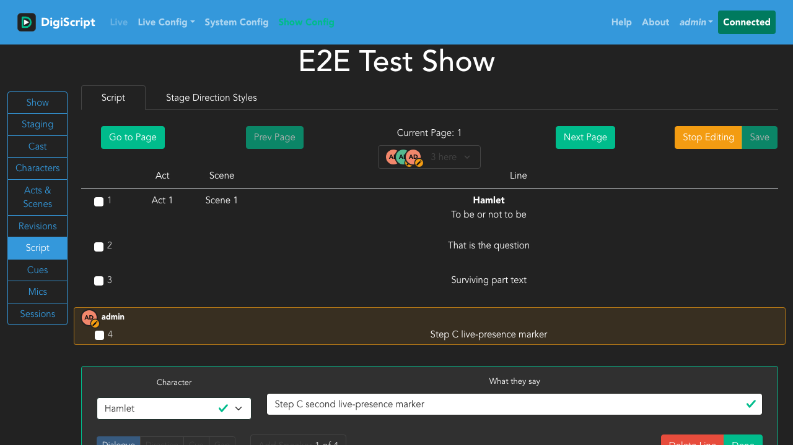
- If your connection briefly drops a change and your editor notices (e.g. a garbled update from another session), it quietly asks the server for a fresh copy of the draft to recover, rather than needing you to rejoin by hand — you may still see a brief "Failed to apply an update" notice while this happens.
- If one of your own edits ever leaves a page corrupted (extremely rare — e.g. a connection glitch mid-edit), you'll see a warning naming the affected page: that page has been reset to empty, and whatever content it held is lost. Everyone else only sees the page reset itself, with no warning, since it wasn't their change.

Cut mode (see below) is unavailable while a draft exists, and vice versa — editing and cutting are mutually exclusive in both modes.

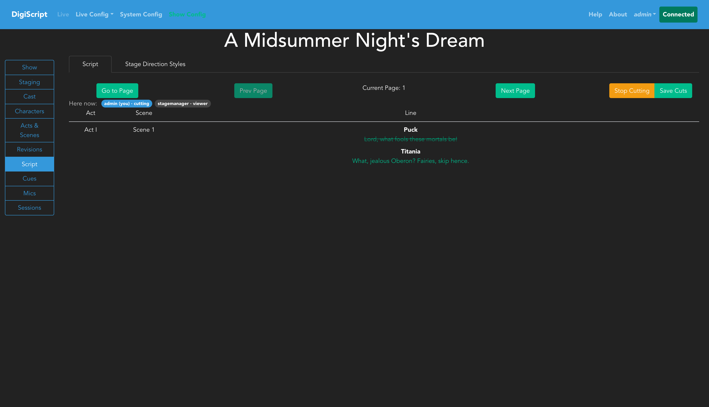

#### Line Types

DigiScript supports four types of script lines, each serving a specific purpose. You add any of them from the end-of-page row of buttons, or from a **+ Add Line Here** divider between two existing lines:

##### Dialogue Lines

The default line type for character speech. Dialogue lines:
- Require a character or character group assignment
- Can contain up to 4 parts (multi-part lines) in FULL mode

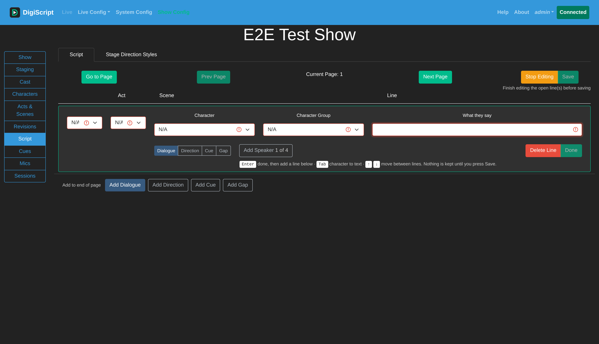

To create a dialogue line:
1. Click **Add Dialogue** (at the end of the page, or from an **+ Add Line Here** divider between two existing lines)
2. Choose the **Character** or **Character Group** speaking the line
3. Enter the line content
4. Click **Done**, or press **Enter** to finish the line and open a new blank dialogue line right below it

A brand-new line also has a **Dialogue / Direction / Cue / Gap** switch, so you can change your mind about its type before finishing it (an already-saved line keeps its type). The Act and Scene are inherited automatically from the line it was added next to, rather than chosen per line — the only exception is the very first line of an empty script, where Act and Scene selects are shown directly since there is nothing to inherit from. To move existing lines into a different act or scene, select them and use **Move to Scene** — see [Selecting Several Lines](#selecting-several-lines) below.

##### Stage Direction Lines

Non-dialogue text for describing actions, movements, or technical directions. Stage direction lines:
- Contain a single text field
- Display in italic formatting with customizable styling
- Can be styled with Stage Direction Styles (system-level or user preferences)
- Optionally tagged to a character or character group (see below)

To create a stage direction, click **Add Direction**.

###### Tagged Stage Directions

A stage direction can optionally be tagged to a **Character** or **Character Group**. This is useful when a stage direction is specific to a character and should appear visually under that character's heading in the script — for example, a move or action described directly after a character speaks.

To tag a stage direction:
1. In the line editor, use the **Character** or **Character Group** dropdown to select who the stage direction belongs to. Leave both as "N/A" for a generic (untagged) stage direction.
2. Only one of character or character group can be set — not both.

When a tagged stage direction is displayed in the script, a character heading appears above it (just as one does above dialogue) whenever the character has changed since the previous line. In the compact live view, the character name appears in the left-hand character column.

##### Cue Lines

Special lines designed for placing technical cues without associated dialogue. Cue lines:
- Have no editable content (displayed as "Cue Lines have no editable content")
- Provide a clean attachment point for cues (LX, SND, etc.)
- Are useful for cues that occur between dialogue or during pauses

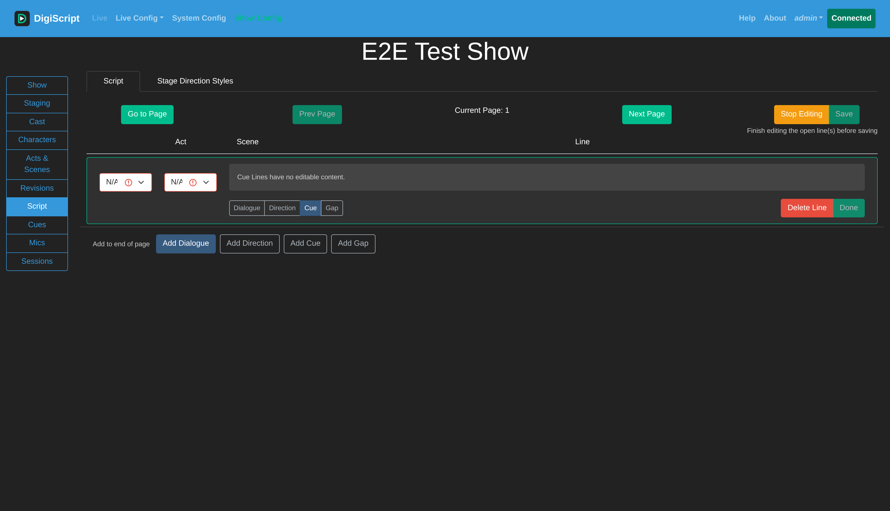

To create a cue line, click **Add Cue**.

##### Spacing Lines

Blank lines that add vertical spacing in your script. Spacing lines:
- Have no editable content (displayed as "Spacing Lines have no editable content")
- Are automatically hidden in live shows

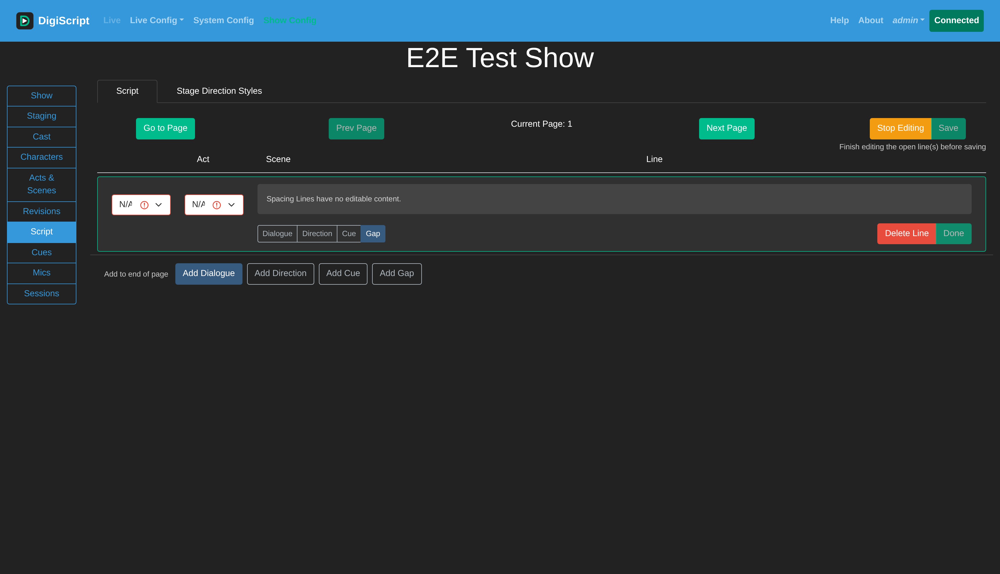

To create a spacing line, click **Add Gap**.

#### Editing a Line

The script page looks like the finished script: click anywhere on a line (or its **Click to edit** link, which appears on hover) to open it in place. While editing:

- **Done** finishes the line and closes it — nothing more happens.
- **Enter** (in the line's text field) finishes the line and opens a new blank dialogue line immediately below it, for typing a scene straight through.
- **Esc** is the same as Done.
- **↑** and **↓** move to the previous or next line without losing your place.
- **Delete Line** removes the line entirely.

The script cannot be saved while any line is still open for editing.

#### Selecting Several Lines

While editing, every line shows a checkbox beside its number. Ticking it selects that line; ticking another line extends the selection to cover both. The selection is always one contiguous block, so while hovering or keyboard-focusing a checkbox, any line whose selected state would flip if you clicked now is outlined to preview the change. Ticking either end of the current selection shrinks it by one from that end, keeping the rest selected; ticking a line in the middle of the selection instead collapses the whole thing down to just that line, since removing a middle line can't keep the rest in one contiguous block either way. The selection is confined to the current page, and clears when you change page or complete any of the actions below. A bar appears above the script showing how many lines are selected, with:

- **Set Character or Group** — reassign the speaker (or character group) across every selected line that has a part at the chosen position, with a preview of what will change before you confirm. Choose which **Part** (1-4) the new assignment targets.
- **Move to Scene** — move every selected line into a different act and scene.
- **Delete n Lines** — remove the whole selection.
- **Clear Selection** — deselect everything without changing anything.

**Esc**, **Enter**, and **↑**/**↓** (see [Editing a Line](#editing-a-line) above) only act while the "What they say" text field has focus, and **Esc**/**Enter** only close a line that currently passes validation — an incomplete line stays open until you either finish it or click **Delete Line**.

#### Multi-Part Lines

Dialogue lines can be made up of multiple parts (up to 4 per line) in **FULL mode**. This is useful for:
- Songs where multiple characters sing simultaneously
- Scenes where characters talk over each other
- Parallel dialogue

Click the green plus button in the line editor to add additional line parts. These will display as multiple columns in the script view.

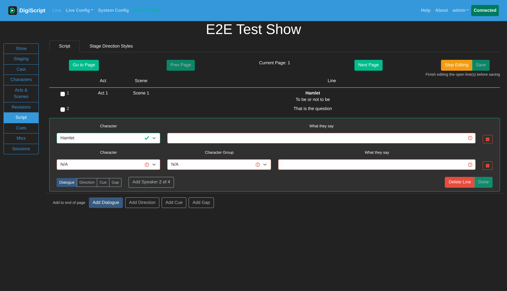

**Note**: In COMPACT mode, multi-part lines are not available as the layout is optimized for single-column display. The add button for additional parts will not be visible when editing shows configured with COMPACT mode.

#### Page Navigation

Use the **Prev Page** and **Next Page** buttons at the top of the editor to navigate between pages of your script as it grows.

#### Cut Mode

Instead of editing, you can click **Cuts** to mark line parts as cut for the live show, without changing the script content itself. Cut mode is exclusive with editing: it's blocked while anyone is editing or has an unsaved draft, and editing is blocked while someone is cutting. Saving cuts does not create a new script revision.

#### Saving Your Work

**Classic editing**: when you're ready to save, ensure no lines are in edit mode, then click the green **Save Script** button. Your changes will be saved to the currently loaded revision.

**Collaborative editing**: click **Save** at any time while editing (see [Collaborative Editing](#collaborative-editing) above) — there's no separate "finish editing first" step, since a draft can be saved while other editors keep working on it.

#### View Mode

After saving, you can switch to view mode to see how the script will appear during a live show:

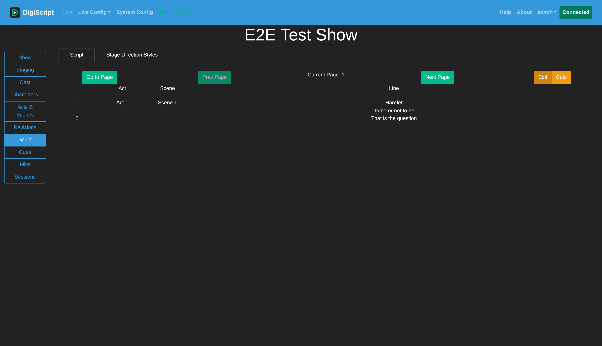

View mode provides a clean reading interface without the editing controls, similar to what you will see during the show.

Once the script has been configured, you can [Configure Cues](./cue_config.md) or learn how to run a [Live Show](./live_show.md).